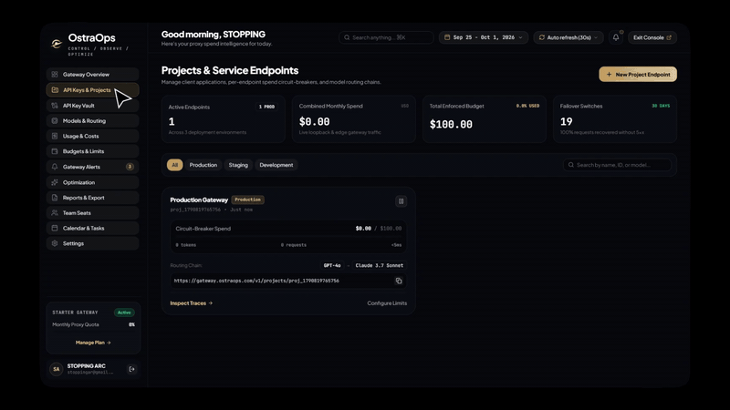

<div align="center">

# OstraOps

**The Open-Source LLM Gateway & Real-Time Spend Controller for AI Apps & Agents.**  
*Stop runaway LLM costs, agent loops, and surprise bills with real-time budget limits.*

[](LICENSE)
[](CONTRIBUTING.md)
[](https://nodejs.org/)
[](#quick-setup-with-your-apps--editors)

[Quick Start (30s)](#quick-start-30-seconds) • [Why OstraOps?](#the-problem-runaway-ai-bills) • [How It Works](#how-it-works) • [Demo](#demo--see-it-in-action) • [Self-Host Full Gateway](#self-hosting-the-team-gateway--dashboard)

</div>

---

## The Problem: Runaway AI Bills

> **You ask an AI coding agent or run a script with a loop, then go grab a coffee.**  
> 20 minutes later, the agent gets stuck in a recursive loop: reading the same 20 files, failing a test, or retrying 50 times.  
> You wake up to a **$380 bill on OpenAI or Anthropic** because official provider dashboards lag by 2 to 8 hours.

**Passive loggers (like Helicone or Langfuse) only tell you about the disaster *after* the money is already gone.**

**OstraOps stops it *before* it happens.**

---

## The Solution: A Real-Time Smart Spend Controller

OstraOps acts as a local proxy between your app / editor and the AI provider. It tracks every token as it streams and calculates cost in real time down to the penny.

- **Hard Budget Limits**: Set a limit (e.g. `$5.00/day`). The second your limit is crossed, OstraOps stops requests locally with an `HTTP 429` code.
- **100% Private Local Guard**: Your code, prompts, and completions never leave your machine. Only token numbers are counted locally.
- **Zero Latency**: Adds less than 1.5ms overhead — tokens stream straight to your app without buffering.
- **Works with Any Provider & Model**: OpenAI (GPT-4o, o3-mini), Anthropic (Claude 3.7 Sonnet), Google Gemini, DeepSeek, and even local Ollama models.

---

## Demo: See It in Action

<div align="center">
  
</div>

- **Full Walkthrough Video**: [Watch `public/demo.mp4`](public/demo.mp4) (Live token odometer, instant 429 cutoff, key creation)
- **Short 22s Launch Teaser**: [Watch `public/launch.mp4`](public/launch.mp4)

---

## Quick Start (30 Seconds)

No account. No signup. No credit card. Just one terminal command:

```bash
npx ostraops-guard
```

Your local spend controller is now running on `http://127.0.0.1:8080`.

### Quick Setup with Your Apps & Editors

#### 1. Cursor & Windsurf
- In **Settings > Models** (or Cascade settings in Windsurf), set your **Base URL** to:
  ```
  http://127.0.0.1:8080/v1
  ```
- Use your normal OpenAI or Anthropic API key. You're fully protected!

#### 2. Cline, Claude Code & Aider
- Set provider to **OpenAI Compatible** (or custom endpoint).
- Set **Base URL** to `http://127.0.0.1:8080/v1`.

#### 3. Python (`openai`, `anthropic`, LangChain, CrewAI)
Just point your SDK's `base_url`:

```python
from openai import OpenAI

client = OpenAI(
    base_url="http://127.0.0.1:8080/v1",
    api_key="your-api-key"
)

# Any script or loop is now protected by your spend limit!
```

#### 4. Node.js / TypeScript
```typescript
import OpenAI from 'openai';

const client = new OpenAI({
  baseURL: 'http://127.0.0.1:8080/v1',
  apiKey: process.env.OPENAI_API_KEY,
});
```

---

## Where is OstraOps Available?

OstraOps is **not** limited to any single tool or editor. Because it uses standard OpenAI and Anthropic API protocols, it works everywhere you use AI:

| Category | Supported Tools & Platforms |
| :--- | :--- |
| **AI Code Editors** | Cursor, Windsurf, VS Code (Cline, Continue.dev), Aider CLI, Claude Code |
| **Languages & Frameworks** | Python (`openai`, `anthropic`), Node.js, TypeScript, Next.js, FastAPI, Go, cURL |
| **Agent Orchestrators** | LangChain, LlamaIndex, CrewAI, AutoGen, LangGraph |
| **Operating Systems** | macOS, Linux, Windows (runs anywhere via `npx ostraops-guard` in seconds) |
| **Supported AI Providers** | OpenAI, Anthropic (Claude), Google Gemini, DeepSeek, Mistral, Meta Llama, and local Ollama |

---

## How It Works

```
[ Cursor / Cline / Python Script ]
               │
               ▼  (localhost:8080)
┌────────────────────────────────────────┐
│           OstraOps Guard               │
│  1. Check budget: $4.85 / $5.00 daily  │
│  2. If >= $5.00 ──► Return HTTP 429    │ (Stops loop instantly)
└──────────────────┬─────────────────────┘
                   │
                   ▼  (Only if within budget)
[ OpenAI / Anthropic / Gemini / DeepSeek ]
                   │
                   ▼  (Stream tokens back)
┌────────────────────────────────────────┐
│  3. Calculate token cost in real time  │
│  4. Save numbers to local SQLite       │ (Zero prompt storage)
└──────────────────┬─────────────────────┘
                   │
                   ▼
[ Your Editor / Completion Received ]
```

---

## Feature Comparison

| Feature | Provider Dashboards | Passive Loggers (Helicone/Langfuse) | **OstraOps** |
| :--- | :--- | :--- | :--- |
| **Real-time hard budget stop** | ❌ No (2-8 hr billing delay) | ❌ No (Alerts after money is spent) | **✅ Yes (Instant local HTTP 429)** |
| **Prompt privacy** | ❌ Sent to cloud provider | ❌ Full prompts logged to remote cloud | **✅ 100% Local (Prompts stay on your PC)** |
| **Setup speed** | N/A | Needs signup + DNS / SDK setup | **✅ 1 command (`npx ostraops-guard`)** |
| **Free for local devs** | Limited | Free tier with cloud limits | **✅ 100% Free & Open Source** |
| **Automatic model fallback** | ❌ No | ✅ Cloud proxy routing | **✅ Intra-family failover** |

---

## Two Ways to Use OstraOps

### Option 1: Solo Guard (Recommended for Individual Devs)
- **Command**: `npx ostraops-guard`
- **What it does**: Runs a lightweight local daemon. Only counts tokens and enforces hard spending limits. Prompts and code never leave your machine.
- **Cost**: Completely free forever.

### Option 2: Team Gateway + Web Dashboard (For Teams & Companies)
If you need centralized company API keys, shared team budgets, latency analytics, and a visual dashboard:

1. **Clone the repository**:
   ```bash
   git clone https://github.com/stoppingarc01-ai/Ostra-FinOps.git
   cd Ostra-FinOps
   npm install
   ```

2. **Configure environment**:
   ```bash
   cp .env.example .env.local
   ```

3. **Start the gateway & web dashboard**:
   ```bash
   # Terminal 1: Gateway server (port 8080)
   npm run gateway

   # Terminal 2: Web Dashboard UI (port 5173)
   npm run dev
   ```

4. Open `http://localhost:5173` to view the full team dashboard.

---

## Automated Self-Checks & Tests

OstraOps includes a built-in test suite verifying rate limiting, token counters, failover, and high-concurrency requests:

```bash
npm test
```

---

## Contributing

We welcome community contributions! Whether you want to add a new model pricing spec, add support for new providers (like Groq, Cerebras, or Ollama), or improve the UI:

1. Fork the repository.
2. Create your branch (`git checkout -b feat/add-groq`).
3. Run tests (`npm test`).
4. Open a Pull Request!

See [CONTRIBUTING.md](CONTRIBUTING.md) for full details.

---

## Community & Support

- ⭐ **Star this repo** if OstraOps saved you from a surprise AI bill!
- 🐛 Found a bug? [Open an issue](https://github.com/stoppingarc01-ai/Ostra-FinOps/issues).
- 💬 Have ideas or feature requests? [Start a discussion](https://github.com/stoppingarc01-ai/Ostra-FinOps/discussions).

---

## License

[MIT License](LICENSE) — free for personal, developer, and commercial use.
